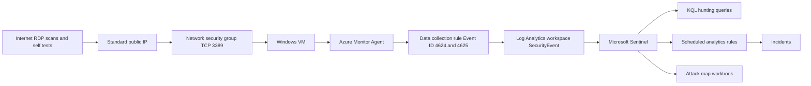

# Home SOC lab: Microsoft Sentinel honeypot

This is a personal lab for Mosa Mofokeng. A Windows virtual machine in her own Azure subscription is exposed to the internet on Remote Desktop (TCP 3389) for a short, timed window. The Azure Monitor Agent sends two Windows Security events to a Log Analytics workspace through a data collection rule. Microsoft Sentinel is enabled on that workspace. Hunting queries, four scheduled analytics rules, and an attack map workbook are the detection work.

The repository is the scaffold. It does not contain a finished run. Query results, incidents, costs, and screenshots are empty on purpose. Mosa fills those in from her own tenant after she follows [docs/lab-guide.md](docs/lab-guide.md).

This lab is the base for three later portfolio labs: a KQL detection library, Entra ID identity attack detection, and Sentinel automated incident response.

## Cost and safety

Read this before you create anything.

* Use your own Azure account. Do not use an employer tenant, customer data, or anyone else's identity data.
* A new Azure free account includes a credit for the first 30 days, 750 hours each month of `Standard_B1s`, `Standard_B2pts_v2`, and `Standard_B2ats_v2` for 12 months, and two 64 GiB P6 disks for 12 months. Confirm the current list on the [Azure free account](https://azure.microsoft.com/pricing/purchase-options/azure-account/) page. Portal prices override this README.
* Those free virtual machine sizes have 1 GiB of RAM. Windows Server often runs poorly on 1 GiB. Any other size is billed for every hour it runs. Read the hourly price before you pick one.
* Windows Server images are often 127 GiB. That disk is larger than the included 64 GiB P6 disks, so it uses credit or creates a charge. A `smalldisk` image is the better choice when the portal offers one.
* New virtual machines get a Standard public IP. Basic public IP addresses are retired, so the older free dynamic address does not apply. A Standard public IP is billed until you delete it. Stopping the virtual machine does not stop that charge.
* Microsoft Sentinel waives the first 10 GB per day for 31 days on a new workspace, for up to 20 workspaces in a tenant. That waiver covers analytics ingestion and Sentinel analysis up to the cap. It does not cover the virtual machine, the disk, or the public IP. If the portal does not show a trial, stop and read the price before you enable Sentinel.
* Set a Log Analytics daily cap of 1 GB before you open RDP to the internet. A public RDP port attracts scans, and "All events" or the Minimal set (which includes process creation) can ingest far more than two event IDs.
* Create a budget alert on the resource group. A budget email does not stop spend. Deleting the resource group stops the meters.
* Do not enable Defender for Servers, Sentinel data lake, UEBA, or a commitment tier in this lab.
* Leave Network Level Authentication on. Use a long unique password stored in a password manager. Do not reuse a password. Do not commit it.
* Open TCP 3389 to the internet only for a window you set in advance (start with 4 hours, and do not pass 24 hours on the first run). Then delete the allow rule.
* If a successful logon appears that you did not make, close port 3389 and delete the resource group. Steps are in the lab guide.
* Tear down `rg-home-soc-lab` when you finish, even if you plan to write the report later. Copy out the screenshots first. Delete removes the logs.

## What this proves

When the evidence and the report are filled in with your own results, this lab shows that you can:

* Build a small collection path: Windows Security log, Azure Monitor Agent, data collection rule, Log Analytics, Microsoft Sentinel.
* Keep the scope small on purpose (Event ID 4624 and Event ID 4625 only) so ingestion stays predictable.
* Hunt failed logons, group them by source IP, and relate a later success to earlier failures.
* Enrich a public IP with geolocation without buying a feed.
* Write scheduled analytics rules and map them to MITRE ATT&CK.
* Put the same events on a map workbook.
* Run a deliberately exposed host with a time limit, a daily cap, a budget alert, and a full delete.

An empty query result is a valid outcome. Write "no rows" rather than borrowing numbers from somewhere else.

## What you still have to add

* Screenshots listed in [docs/screenshot-checklist.md](docs/screenshot-checklist.md), saved under `evidence/` after you redact them.
* The results and lessons sections in this README.
* The report from [docs/report-template.md](docs/report-template.md).

Do not add image files until they are yours. Do not commit CSV exports, `.rdp` files, or passwords.

## Skills and tools

Skills you practise here:

* Microsoft Sentinel workspace setup, data connectors, scheduled analytics rules, incidents, and workbooks
* KQL against the `SecurityEvent` table
* Azure Monitor Agent and data collection rules, including an XPath filter
* Windows logon auditing, Event ID 4624 and 4625, and logon type 3 versus logon type 10
* Network security groups
* MITRE ATT&CK mapping for the detections you author
* Azure cost controls: budget alerts, a daily ingestion cap, and resource group teardown
* Redaction before you publish evidence

Tools, all on free tiers or already included with the Azure account:

* Azure portal
* Microsoft Sentinel and Log Analytics
* Azure Monitor Agent
* Windows Server Event Viewer and `auditpol`
* KQL, including `geo_info_from_ip_address()` (GeoLite2 data shipped with the function, no separate subscription)

No paid threat intelligence feed is required. Defender for Servers is out of scope because Plan 2 is a paid product.

## MITRE ATT&CK

These are the techniques the detections are built to observe. They are not a list of confirmed findings. Your report should say which ones your own events actually matched.

| ID | Name | Tactic in the rules | What the lab looks for |
| --- | --- | --- | --- |
| T1110 | Brute Force | Credential Access | Many failed logons |
| T1110.001 | Password Guessing | Credential Access | Many failures from one public IP |
| T1110.003 | Password Spraying | Credential Access | Many public IPs failing against one account name on this single VM. This is not a spray across an organisation. |
| T1078 | Valid Accounts | Initial Access, and also other tactics in ATT&CK | A logon succeeds |
| T1078.003 | Local Accounts | Initial Access | The account is a local Windows account |
| T1133 | External Remote Services | Initial Access, Persistence | RDP is reachable from the internet on purpose |
| T1021.001 | Remote Desktop Protocol | Lateral Movement | The successful logon is RDP (logon type 10). On this one VM that is the entry path, not movement through a domain |

Technique references: [T1110](https://attack.mitre.org/techniques/T1110/), [T1078](https://attack.mitre.org/techniques/T1078/), [T1133](https://attack.mitre.org/techniques/T1133/), [T1021.001](https://attack.mitre.org/techniques/T1021/001/).

## Architecture



The network security group starts with RDP open only to your current public IP. You widen it to the internet for the collection window, then you remove that rule. The data collection rule is custom, not "All events".

## Repository structure

```text
.
├── README.md
├── LICENSE
├── .gitignore
├── analytics-rules/
│   ├── rdp-brute-force-single-source.yaml
│   ├── successful-rdp-after-failures.yaml
│   ├── external-rdp-logon.yaml
│   └── many-sources-one-account.yaml
├── docs/
│   ├── lab-guide.md
│   ├── screenshot-checklist.md
│   └── report-template.md
├── evidence/
│   └── README.md
├── kql/
│   ├── failed-logons-4625.kql
│   ├── brute-force-by-source-ip.kql
│   ├── successful-logon-after-failures.kql
│   └── geolocation-enrichment.kql
└── workbook/
    └── honeypot-attack-map.json
```

The YAML files are the rule definitions you recreate in the portal. They are not deployed automatically. The workbook JSON is a skeleton you paste into a Sentinel workbook.

## How to reproduce

1. Read the cost and safety section above, then [docs/lab-guide.md](docs/lab-guide.md) from the start. Do not skip the account check.
2. Create the resource group, budget, Log Analytics workspace, daily cap, and Sentinel before the virtual machine.
3. Build the virtual machine with inbound ports set to None. Allow RDP only from your IP. Turn on logon auditing. Generate one failed logon and one success yourself.
4. Create the data collection rule with the custom XPath in the lab guide. Wait until `SecurityEvent` shows those two event IDs.
5. Run the queries in `kql/`. Create the four rules in `analytics-rules/` with the portal fields in the lab guide. Import `workbook/honeypot-attack-map.json`.
6. Only then allow TCP 3389 from Any, for the window you already scheduled. Check ingestion after the first hour.
7. Remove the internet rule. Take the screenshots in [docs/screenshot-checklist.md](docs/screenshot-checklist.md). Redact them using [evidence/README.md](evidence/README.md).
8. Delete the resource group. Record the cost you actually see, including zero.
9. Write the report from [docs/report-template.md](docs/report-template.md) and replace the placeholders below.

Active work is about 6 to 8 hours, plus the collection window and the write up. Each part has its own estimate in the lab guide.

## Results

Replace this section after your lab. Use only numbers from your workspace, your budget, and Cost analysis. If something returned nothing, write "no rows" or "no incident".

| Item | Your result |
| --- | --- |
| Date you built the lab, and the region | |
| Time you opened TCP 3389 to the internet, and the time you closed it (SAST and UTC) | |
| Daily cap, and whether collection stopped because of it | |
| Failed logon query: row count, or no rows | |
| Brute force query: threshold you used, and row count or no rows | |
| Success after failures: self test, unknown success, or no rows | |
| Geolocation approach you used, and whether locations came back | |
| Analytics rules that created incidents, or none | |
| Cost analysis figure for `rg-home-soc-lab` after delete | |

## Lessons learned

Replace this section after teardown. Write in your own words.

* What logon type did the failed RDP attempts use, and did that match the note about Network Level Authentication?
* What did you change in a threshold or a query, and why?
* What would you collect next time, and what would you leave out because of cost?
* What should the later labs reuse from this one?

Planned follow on labs, not built yet:

* **KQL Detection Library.** More hunting queries, kept in a form you can reuse, starting from the four files in `kql/`.
* **Entra ID Identity Attack Detection.** The same Sentinel pattern, aimed at sign in logs rather than a Windows honeypot.
* **Sentinel Automated Incident Response.** Automation on incidents from the scheduled rules in `analytics-rules/`.

## About me

Placeholder for Mosa Mofokeng. Replace this with two or three sentences in your own words.

Facts you may want to include: junior cyber security analyst in Cape Town, South Africa, ISC2 CC, and Microsoft SC-200. Only write what you want a hiring manager to read.

* LinkedIn: add your profile URL here
* GitHub: [https://github.com/Sasa021](https://github.com/Sasa021)

## References

* [Azure free account](https://azure.microsoft.com/pricing/purchase-options/azure-account/)
* [Microsoft Sentinel billing](https://learn.microsoft.com/azure/sentinel/billing)
* [Windows security event sets](https://learn.microsoft.com/azure/sentinel/windows-security-event-id-reference)
* [Windows Security Events via AMA](https://learn.microsoft.com/azure/sentinel/connect-services-windows-based)
* [geo_info_from_ip_address()](https://learn.microsoft.com/kusto/query/geo-info-from-ip-address-function)
* [Scheduled analytics rules](https://learn.microsoft.com/azure/sentinel/scheduled-rules-overview)
